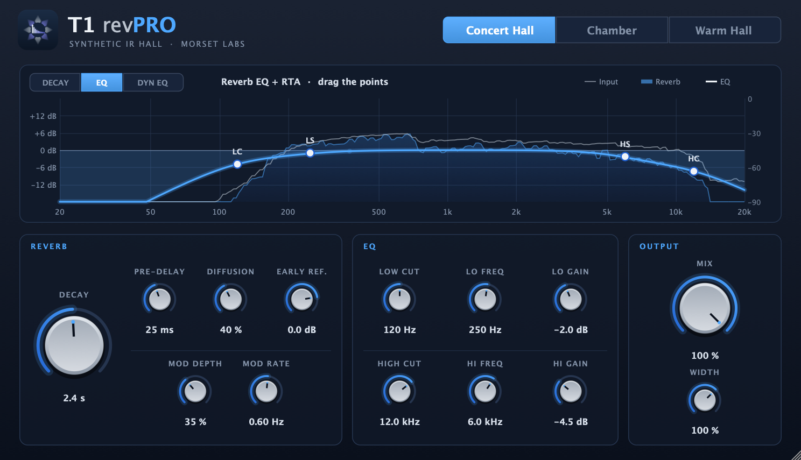

# T1 revPRO

*English · [Norsk](README.no.md)*

Hall reverb in VST3 format (and AU on Mac) with a soft, dense and natural hall character, designed with violin and other strings in mind. The reverb is a **synthetic impulse response** that the plugin computes itself and plays back with convolution. You get the smoothness of a convolution reverb together with free control over length, predelay, diffusion and early reflections, as in an algorithmic reverb. The plugin has **0 samples of latency**. Built with JUCE 9.0.6.




## How it works

Whenever you change the room, Decay, Pre-Delay, Diffusion or Early Ref., a background thread computes a new stereo impulse response, and the convolution engine swaps it in without clicks:

1. **Early reflections:** 20–26 short, soft pulses during the first 60–100 ms, with their own pattern, panning and inter-channel time difference for each room.
2. **Tail:** independent noise in the left and right channels (decorrelated stereo, correlation ≈ 0), split into five frequency bands that each decay at their own rate. The bass hangs on a little longer, and the treble decays about twice as fast as the midrange, as it does in a real hall.
3. **Soft onset:** the tail builds up over 35–60 ms instead of starting abruptly.
4. **Softer midrange:** the tail is gently lowered around 950 Hz (700–1200 Hz), 1.5 dB at the start and about 4 dB late in the tail. The midrange therefore decays slightly faster and does not get harsh.
5. **Modulation:** the IR is split in two. The first 35 ms after the predelay (the early reflections) play unmodulated. The tail goes through two subtly modulated delays per channel, each with its own uneven LFO and different in the left and right channels. This gives the same lively, wide tail as in algorithmic halls instead of a static impulse response. At 0 % the sound is exactly the synthetic IR.
6. **Diffusion** controls echo density, from 150 echoes per second (sparse and "grainy") to fully dense noise, and smears the early reflections.

The level follows the length as in a real room: a longer reverb gives more reverb, while the start of the tail stays at the same level. Measured in the tests, RT60 is within ±10 % of the set value from 1 to 10 s, also at 44.1 kHz.

## Controls

| Control | What it does |
|---|---|
| **Concert Hall / Chamber / Warm Hall** | Room type. Sets the reflection pattern, how fast the treble decays (from 6–8 kHz) and the bass in the tail. |
| **Decay** (0.3–10.0 s, 0.1 s steps) | Reverb time (RT60) in the midrange. Strings: 1.8–2.6 s. 5–10 s for cathedral and ambient. |
| **Pre-Delay** (0–150 ms) | Time before the reverb starts. More predelay keeps attacks and bow strokes clear. Strings: 20–30 ms. |
| **Diffusion** (0–100 %) | Echo density. High gives a smooth, dense tail. Low gives a sparse tail where individual echoes can be heard. Default 80 %. |
| **Mod Depth** (0–100 %) | How much the tail is modulated (up to ±1.5 ms). Makes the tail livelier, wider and less static. Default 35 %. Strings: 25–45 %. |
| **Mod Rate** (0.10–3.00 Hz) | Speed of the modulation. 0.4–0.8 Hz sounds natural, and faster gives more chorus. Default 0.60 Hz. |
| **Early Ref.** (−24 to +6 dB) | Level of the early reflections. More gives closeness and a sense of space, less gives a smoother tail. |
| **Low Cut** (Off–500 Hz) | 12 dB/oct high-pass on the reverb. Keeps the bass clean. |
| **Lo Freq / Lo Gain** | Low shelf on the reverb, 50–1000 Hz, ±12 dB. |
| **High Cut** (2 kHz–Off) | 12 dB/oct low-pass on the reverb. A lower value sounds softer and further away. |
| **Hi Freq / Hi Gain** | High shelf on the reverb, 1–16 kHz, ±12 dB. A small cut (−2 to −4 dB) tames bow noise in the tail. |
| **Dynamic EQ: Freq / Q / Thresh / Range** (two bands) | Peaking filters on the reverb that only attenuate when the level in the band exceeds Thresh (RMS in dBFS). Range is the maximum attenuation (0 = off). 3:1, attack 8 ms, release 150 ms. Band 1: 950 Hz, −3 dB. Band 2 is off by default. |
| **Mix** (0–100 %) | Dry/wet. Up to 50 % the dry signal stays at full level, above that it is faded down. On an aux/send: 100 %. |
| **Width** (0–150 %) | Stereo width of the reverb. 0 % = mono, 100 % = as the room, 150 % = extra wide. |

The EQ only affects the reverb, never the dry signal. Double-click a knob for its default value, and click the number to type a value ("3.7" and "3,7" both work). The window can be scaled from 75 to 200 %.

## Display

- **DECAY:** how the reverb decays in the bass (purple), midrange (blue) and treble (dashed silver). The vertical lines are the early reflections, and the dashed line is the predelay. At low diffusion the tail is shown as grains.
- **EQ:** real-time RTA of the input (silver line) and the reverb after EQ (blue area), in dBFS with a 3 dB/oct tilt. The EQ curve is drawn on top with points for Low Cut, Low Shelf, High Shelf and High Cut.
- **DYN EQ:** the reverb before (silver line) and after (blue area) the dynamic EQ, without tilt. The white curve shows the current attenuation, and the dashed curve shows the maximum attenuation (Range). The dashed line is the threshold, and the thick line is the level in the band. The EQ group shows the DYNAMIC EQ knobs while this tab is open.
- **Drag in the display:** in the EQ tab you drag LC, LS, HS and HC (frequency, and gain for the shelves). In the DYN EQ tab you drag the circles (frequency and threshold) and the triangles (Range). The mouse wheel over a DYN handle changes Q, and double-click gives the default value.
- The tab switches automatically when you turn a knob in the REVERB, EQ or DYNAMIC EQ section.

## Limitations

- The rooms are synthetic and not measured in real halls. The character resembles large hardware halls, but the plugin uses no data, presets or names from commercial products.
- When Decay, Pre-Delay, Diffusion or Early Ref. changes, a new impulse response is created in the background. Automating these therefore gives smooth transitions, not sample-accurate changes. EQ, Dynamic EQ, Mod, Width and Mix take effect immediately.
- The modulation is applied to the tail after the convolution, not inside a feedback network as in an algorithmic reverb. At high depth and rate it can therefore sound like chorus.

## Building

### Via GitHub (recommended)
The workflow in `.github/workflows/build-macos.yml` builds VST3 and AU as a universal binary (Apple Silicon and Intel), runs the tests and pluginval, and creates a `.pkg` installer. Finished versions are under **Releases**. A new release is created automatically when `VERSION` in `CMakeLists.txt` is increased and pushed to `main`.

### Locally on Mac
```bash
cmake -B build -G Xcode
cmake --build build --config Release --target T1revPRO_VST3 T1revPRO_AU
```
Copy `T1 revPRO.vst3` to `~/Library/Audio/Plug-Ins/VST3/` and `T1 revPRO.component` to `~/Library/Audio/Plug-Ins/Components/`.

Without Xcode (Command Line Tools only), `cmake -B build -G "Unix Makefiles" -DCMAKE_BUILD_TYPE=Release` also works. `bygg.sh` builds, tests, signs (ad hoc) and installs in one go. It uses a local JUCE copy in `./JUCE` if there is one.

`lag_dmg.sh` then creates `dist/T1revPRO-<version>-macOS.dmg` with the `.pkg` installer, the plugins for manual installation (with shortcuts to the plug-in folders), "Les meg.txt" and the logo as the disk icon.

## Tests
`cmake -B build -DT1REVPRO_BUILD_TESTS=ON`, then `T1revPROTest [folder]`:
- **Reverb:** measured RT60 at 1.0–10.0 s, predelay, decorrelated stereo, that the tail is silent after the right time, room switching and early reflection level.
- **Diffusion:** sparse tail at 0 % (high kurtosis) and dense tail at 100 %.
- **EQ:** that the curve in the GUI matches the sound (shelf, low cut, high cut).
- **Modulation:** that 0 % gives exactly the synthetic IR, and that 100 % makes the tail change over time without changing the early reflections, level or RT.
- **Midrange:** that 700–1200 Hz in the tail sits 1.5–4.5 dB below the neighbouring ranges.
- **Dynamic EQ:** that a strong tone in the band is attenuated by Range, that weak signals and tones outside the band are unchanged, and that the attenuation is reported to the display.
- **Drag handles:** that LS, HC, threshold and Range change correctly when the handles are moved.
- **RTA:** correct level in dBFS, no leakage, and a full queue without crashing.
- **Other:** 44.1 and 48 kHz, mix 0 = unchanged dry signal, saving and restoring state, and that the IR is swapped in the background.
- **GUI:** draws `screenshot.png` (EQ and RTA), `screenshot-decay.png` and `screenshot-dyn.png` to the folder.

## Code structure
| File | Contents |
|---|---|
| `Source/RomSyntese.*` | Creates the impulse response: the rooms, early reflections, frequency-dependent tail and diffusion. |
| `Source/Modulasjon.h` | Modulated delays for the tail (Hermite interpolation). |
| `Source/Analysator.*` | RTA: lock-free queue from the audio thread and FFT with smoothing for the display. |
| `Source/PluginProcessor.*` | Parameters, background thread for new impulse responses, convolution, tail modulation, EQ, dynamic EQ, width and mix. |
| `Source/PluginEditor.*` | GUI: DECAY, EQ and DYN EQ displays with drag handles and RTA, knobs, room selection and a scalable window. |
| `Tests/T1revPROTest.cpp` | The tests and screenshots above. |
| `assets/` | Logo (SVG and PNG) and `lag_png.py`, which creates the PNGs from the SVG. |

The code follows common VST3/JUCE practice: the audio thread does not allocate, lock or do file I/O. New impulse responses are created on a separate thread and swapped in without locks.

## License
JUCE is licensed under AGPLv3 or a commercial license. For private use this is not a problem. If the plugin is shared or sold as closed source, a commercial JUCE license may be required.
