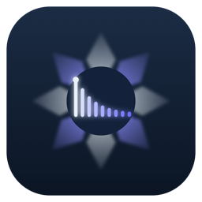
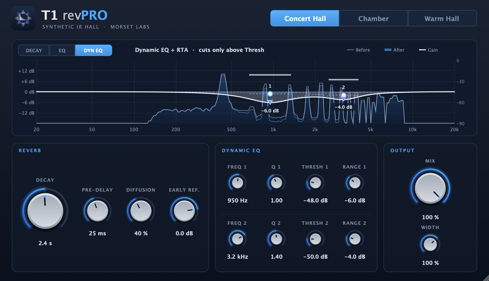

# T1 revPRO

Romklang (hall) i VST3-format (og AU på Mac) med myk, tett og naturlig salkarakter, laget med tanke på fiolin og andre strykere. Klangen er en **syntetisk impulsrespons** som pluginen regner ut selv og spiller av med konvolusjon. Du får jevnheten fra en konvolusjonsklang og samtidig fri kontroll over lengde, predelay, diffusion og tidlige refleksjoner, som i en algoritmisk klang. Pluginen har **0 samples latens**. Bygget med JUCE 9.0.6.




## Slik fungerer det

Hver gang du endrer rom, Decay, Pre-Delay, Diffusion eller Early Ref., regner en bakgrunnstråd ut en ny stereo-impulsrespons, og konvolusjonsmotoren bytter den inn uten klikk:

1. **Tidlige refleksjoner:** 20–26 korte, myke pulser i løpet av de første 60–100 ms, med eget mønster, panorering og tidsforskjell mellom kanalene for hvert rom.
2. **Hale:** uavhengig støy i venstre og høyre kanal (dekorrelert stereo, korrelasjon ≈ 0), delt i fem frekvensbånd som dør ut med hver sin hastighet. Bassen henger litt lenger, og diskanten dør ut omtrent dobbelt så raskt som mellomtonen, slik den gjør i en ekte sal.
3. **Myk innsvinging:** halen bygger seg opp over 35–60 ms i stedet for å starte brått.
4. **Mykere mellomtone:** halen senkes mildt rundt 950 Hz (700–1200 Hz), 1,5 dB fra start og om lag 4 dB sent i halen. Mellomtonen dør dermed litt raskere ut og blir ikke hard.
5. **Diffusion** styrer ekkotettheten, fra 150 ekko i sekundet (glissen og «kornete») til helt tett støy, og smører de tidlige refleksjonene ut.

Nivået følger lengden slik det gjør i et ekte rom: lengre klang gir mer klang, mens starten av halen ligger på samme nivå. Målt i testene er RT60 innenfor ±10 % av innstilt verdi fra 1 til 10 s, også ved 44,1 kHz.

## Kontroller

| Kontroll | Hva den gjør |
|---|---|
| **Concert Hall / Chamber / Warm Hall** | Romtype. Bestemmer refleksjonsmønsteret, hvor fort diskanten dør (fra 6–8 kHz) og bassen i halen. |
| **Decay** (0,3–10,0 s, steg på 0,1 s) | Etterklangstid (RT60) i mellomtonen. Strykere: 1,8–2,6 s. 5–10 s for katedral og ambient. |
| **Pre-Delay** (0–150 ms) | Tid før klangen starter. Mer predelay holder anslag og buestrøk tydelige. Strykere: 20–30 ms. |
| **Diffusion** (0–100 %) | Ekkotetthet. Høy gir glatt, tett hale. Lav gir glissen hale der enkeltekko høres. Standard 80 %. |
| **Early Ref.** (−24 til +6 dB) | Nivå på de tidlige refleksjonene. Mer gir nærhet og romfølelse, mindre gir en glattere hale. |
| **Low Cut** (Off–500 Hz) | High-pass 12 dB/okt på klangen. Holder bassen ren. |
| **Lo Freq / Lo Gain** | Low shelf på klangen, 50–1000 Hz, ±12 dB. |
| **High Cut** (2 kHz–Off) | Low-pass 12 dB/okt på klangen. Lavere verdi låter mykere og lenger unna. |
| **Hi Freq / Hi Gain** | High shelf på klangen, 1–16 kHz, ±12 dB. Litt kutt (−2 til −4 dB) temmer buestøy i halen. |
| **Dynamic EQ: Freq / Q / Thresh / Range** (to bånd) | Peaking-filtre på klangen som bare demper når nivået i båndet går over Thresh (RMS i dBFS). Range er maks demping (0 = av). 3:1, attack 8 ms, release 150 ms. Bånd 1: 950 Hz, −3 dB. Bånd 2 er av som standard. |
| **Mix** (0–100 %) | Tørt/vått. Opp til 50 % står det tørre signalet fullt, over det tones det ned. På en aux/send: 100 %. |
| **Width** (0–150 %) | Stereobredde på klangen. 0 % = mono, 100 % = som rommet, 150 % = ekstra bred. |

EQ-en virker bare på klangen, aldri på det tørre signalet. Dobbeltklikk på en knapp for standardverdi, og klikk på tallet for å skrive inn en verdi («3.7» og «3,7» virker begge). Vinduet kan skaleres fra 75 til 200 %.

## Visning

- **DECAY:** hvordan klangen dør ut i bass (lilla), mellomtone (blå) og diskant (stiplet sølv). Strekene er de tidlige refleksjonene, og den stiplede linjen er predelay. Ved lav diffusion vises halen som korn.
- **EQ:** sanntids-RTA av inngangen (sølvlinje) og klangen etter EQ (blått felt), i dBFS med 3 dB/okt helning. EQ-kurven ligger oppå med punkter for Low Cut, Low Shelf, High Shelf og High Cut.
- **DYN EQ:** klangen før (sølvlinje) og etter (blått felt) den dynamiske EQ-en, uten tilt. Den hvite kurven viser dempingen akkurat nå, og den stiplede kurven viser maks demping (Range). Den stiplede streken er terskelen, og den tykke streken er nivået i båndet. EQ-gruppen viser DYNAMIC EQ-knottene når denne fanen er åpen.
- **Dra i bildet:** i EQ-fanen drar du LC, LS, HS og HC (frekvens, og gain for shelfene). I DYN EQ-fanen drar du sirklene (frekvens og terskel) og trekantene (Range). Musehjulet over et DYN-håndtak endrer Q, og dobbeltklikk gir standardverdi.
- Fanen skifter automatisk når du vrir på en knapp i REVERB-, EQ- eller DYNAMIC EQ-delen.

## Begrensninger

- Rommene er syntetiske og ikke målt i virkelige saler. Karakteren ligner store maskinvare-haller, men pluginen bruker ingen data, presets eller navn fra kommersielle produkter.
- Når Decay, Pre-Delay, Diffusion eller Early Ref. endres, lages en ny impulsrespons i bakgrunnen. Automasjon av disse gir derfor myke overganger, ikke sample-nøyaktige endringer. EQ, Dynamic EQ, Width og Mix virker umiddelbart.
- Klangen er statisk. Den har ingen modulasjon («chorus» i halen) slik noen algoritmiske klanger har.

## Bygging

### Via GitHub (anbefalt)
Workflowen i `.github/workflows/build-macos.yml` bygger VST3 og AU som universal binary (Apple Silicon og Intel), kjører testene og pluginval, og lager en `.pkg`-installer. Ferdige versjoner ligger under **Releases**. En ny release lages automatisk når `VERSION` i `CMakeLists.txt` økes og pushes til `main`.

### Lokalt på Mac
```bash
cmake -B build -G Xcode
cmake --build build --config Release --target T1revPRO_VST3 T1revPRO_AU
```
Kopier `T1 revPRO.vst3` til `~/Library/Audio/Plug-Ins/VST3/` og `T1 revPRO.component` til `~/Library/Audio/Plug-Ins/Components/`.

Uten Xcode (bare Command Line Tools) virker `cmake -B build -G "Unix Makefiles" -DCMAKE_BUILD_TYPE=Release` også. `bygg.sh` bygger, tester, signerer (ad hoc) og installerer i ett. Den bruker en lokal JUCE-kopi i `./JUCE` hvis den finnes.

`lag_dmg.sh` lager deretter `dist/T1revPRO-<versjon>-macOS.dmg` med `.pkg`-installer, pluginene for manuell installasjon (med snarveier til plugin-mappene), «Les meg.txt» og logoen som diskikon.

## Tester
`cmake -B build -DT1REVPRO_BUILD_TESTS=ON`, deretter `T1revPROTest [mappe]`:
- **Klang:** målt RT60 ved 1,0–10,0 s, predelay, dekorrelert stereo, at halen er stille etter riktig tid, romskifte og nivå på tidlige refleksjoner.
- **Diffusion:** glissen hale ved 0 % (høy kurtosis) og tett hale ved 100 %.
- **EQ:** at kurven i GUI-et stemmer med lyden (shelf, low cut, high cut).
- **Mellomtone:** at 700–1200 Hz i halen ligger 1,5–4,5 dB under naboområdene.
- **Dynamisk EQ:** at en sterk tone i båndet dempes med Range, at svakt signal og toner utenfor båndet ikke endres, og at dempingen meldes til visningen.
- **Dra-håndtak:** at LS, HC, terskel og Range endres riktig når håndtakene flyttes.
- **RTA:** riktig nivå i dBFS, ingen lekkasje og full kø uten krasj.
- **Ellers:** 44,1 og 48 kHz, mix 0 = uendret tørt signal, lagring og gjenoppretting av tilstand, og at IR-en byttes i bakgrunnen.
- **GUI:** tegner `screenshot.png` (EQ og RTA), `screenshot-decay.png` og `screenshot-dyn.png` til mappen.

## Kodestruktur
| Fil | Innhold |
|---|---|
| `Source/RomSyntese.*` | Lager impulsresponsen: rommene, tidlige refleksjoner, frekvensavhengig hale og diffusion. |
| `Source/Analysator.*` | RTA: låsefri kø fra lydtråden og FFT med glatting for visningen. |
| `Source/PluginProcessor.*` | Parametere, bakgrunnstråd for nye impulsresponser, konvolusjon, EQ, dynamisk EQ, bredde og mix. |
| `Source/PluginEditor.*` | GUI: DECAY-, EQ- og DYN EQ-visning med dra-håndtak og RTA, knotter, romvalg og skalerbart vindu. |
| `Tests/T1revPROTest.cpp` | Testene og skjermbildene over. |
| `assets/` | Logo (SVG og PNG) og `lag_png.py`, som lager PNG-ene fra SVG-en. |

Koden følger vanlig praksis for VST3/JUCE: lydtråden allokerer ikke, låser ikke og gjør ingen fil-I/O. Nye impulsresponser lages i en egen tråd og byttes inn uten låser.

## Lisens
JUCE er lisensiert under AGPLv3 eller kommersiell lisens. For privat bruk er det uproblematisk. Skal pluginen deles eller selges som lukket kode, kan det kreves en kommersiell JUCE-lisens.
